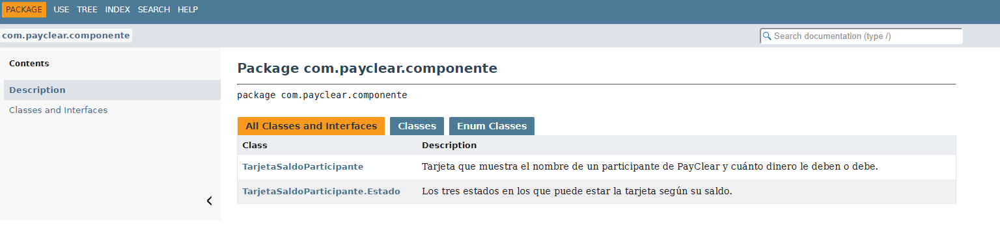

# PayClear - Documentación Técnica - SPRINT 3

* **Módulo:** Desarrollo de Interfaces (DII)
* **Equipo:** Jesús, José Luis, Guillermo
* **Fecha de entrega Sprint 3:** 20/11/2026

### Coevaluación
| Integrante | Nota (%) |
| :--- | :--- |
| Guillermo Eugui | 0% |
| Jesús Cabeza | 0% | 
| JoseLuís Segura | 0% |

## Pruebas, Calidad y Documentación (QA Tester)

**Responsable:** Guillermo Eugui Sánchez

Antes de integrar `TarjetaSaldoParticipante` en las vistas principales de PayClear, se han creado 6 pruebas automatizadas en `PayClearComponentes/test/TarjetaSaldoParticipanteTest.java`, totalmente desacoplada de `VistaPrincipal`, para validar el estado inicial, los setters, la lógica visual, el control de errores y los eventos del componente.

### Enfoque técnico (JUnit 4.13.2 + EDT nativo)

Como PayClear está desarrollado en Java Swing con FlatLaf y gestionado con **Ant** en NetBeans, se ha utilizado **JUnit 4.13.2 junto con Hamcrest** (que incluye `assertThrows`) para garantizar la compatibilidad total con el ejecutor de pruebas de Ant en el IDE, evitando los fallos de detección del motor de JUnit 5 en proyectos Ant. Para las pruebas de interacción de interfaz se simula el evento de ratón directamente sobre el Event Dispatch Thread (EDT) mediante `SwingUtilities.invokeAndWait` y `MouseEvent`.

### Resumen de los casos probados

| # | Método de prueba | Tipo | Qué se comprueba | Resultado |
| :-: | :--- | :--- | :--- | :-: |
| 1 | `testValoresPorDefecto` | Unitaria | Que el constructor sin argumentos inicialice el nombre a `"Participante"`, el saldo a `0.0` y el foco activado (`isFocusable()`). | PASS |
| 2 | `testSettersModificanEstadoInterno` | Unitaria | Que `setNombreParticipante` y `setSaldoActual` actualicen correctamente el estado interno (`assertEquals`). | PASS |
| 3 | `testEstadoVisualColoresPorSaldo` | Visual | Que el color de estado corresponda a acreedor (verde) con saldo positivo, deudor (rojo) con negativo y saldado (gris) con cero. | PASS |
| 4 | `testValoresNulosLanzanExcepcion` | Robustez | Que pasar nombre nulo o en blanco, o cualquiera de los tres colores a `null`, lance `IllegalArgumentException` (`assertThrows`). | PASS |
| 5 | `testClicDisparaActionListener` | UI (Ratón) | Que simular un clic izquierdo (`MouseEvent.MOUSE_CLICKED`) en el EDT notifique al `ActionListener` registrado. | PASS |
| 6 | `testCambioSaldoDisparaPropertyChangeEvent` | Eventos | Que modificar el saldo dispare un `PropertyChangeEvent` para `PROP_SALDO` con el valor antiguo (`0.0`) y el nuevo (`100.0`). | PASS |

### Salida de las pruebas

La batería completa se ha ejecutado desde NetBeans con el 100 % de las pruebas superadas (`6/6`) en `0,151 s`:

```text
Testsuite: TarjetaSaldoParticipanteTest
Tests run: 6, Failures: 0, Errors: 0, Skipped: 0, Time elapsed: 0,151 sec

test-single:
BUILD SUCCESSFUL (total time: 1 second)
```



