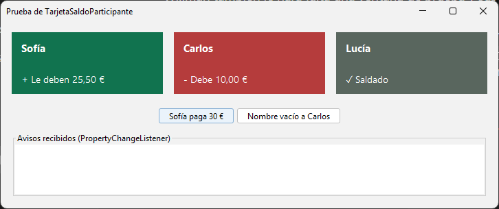
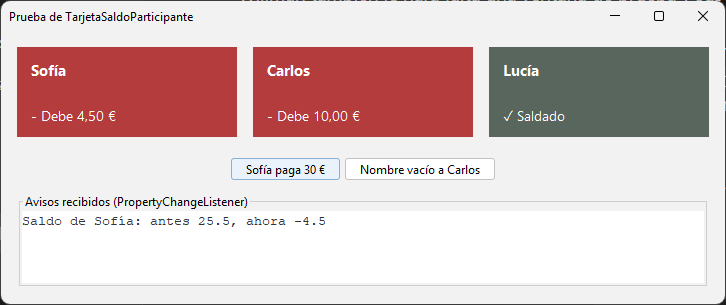
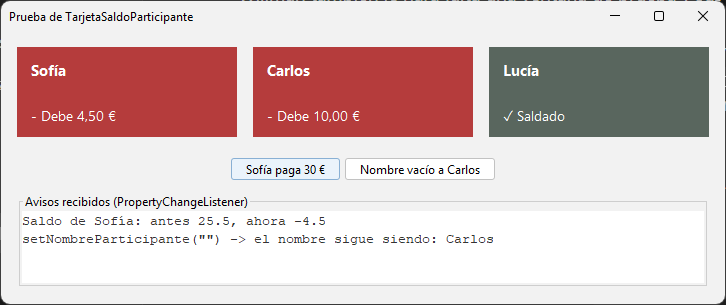
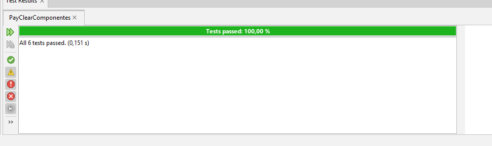

# PayClear - Documentación Técnica - SPRINT 3
 
* **Módulo:** Desarrollo de Interfaces (DII)
* **Equipo:** Jesús, José Luis, Guillermo
* **Sprint:** 3 – Modularidad y componentes propios (RA 3)
* **Fecha de entrega Sprint 3:** 27/11/2026 (ampliada desde el 20/11/2026)
### Coevaluación
 
| Integrante | Nota (%) |
| :--- | :--- |
| Guillermo Eugui | 95% |
| Jesús Cabeza | 85% |
| JoseLuís Segura | 90% |
 
### Índice
 
* [3.1. Arquitectura del componente TarjetaSaldoParticipante](#31-arquitectura-del-componente-tarjetasaldoparticipante)
* [3.2. Modelo de eventos y respuestas interactivas](#32-modelo-de-eventos-y-respuestas-interactivas)
* [3.3. Pruebas unitarias del componente](#33-pruebas-unitarias-del-componente)
* [3.4. Javadoc y empaquetado del .jar](#34-javadoc-y-empaquetado-del-jar)
* [3.5. Integración en VistaPrincipal](#35-integración-en-vistaprincipal)
* [Fuentes](#fuentes)
### Reparto del sprint
 
| Apartado | Responsable |
| :--- | :--- |
| 3.1. Arquitectura del componente | José Luis Segura |
| 3.2. Eventos e interacción | Jesús Cabeza |
| 3.3. Pruebas unitarias | Guillermo Eugui |
| 3.4. Javadoc y .jar | Guillermo Eugui |
| 3.5. Integración en PayClear | Los tres |
 
---
 
## 3.1. Arquitectura del componente TarjetaSaldoParticipante
 
**Responsable:** José Luis Segura Fernández
 
En este apartado contamos cómo hemos construido nuestro componente propio, la **TarjetaSaldoParticipante**: qué es, con qué herramientas lo hemos hecho, qué propiedades y métodos tiene y por qué lo hemos diseñado así.
 
### 3.1.1. Qué es la tarjeta y por qué un componente propio
 
La tarjeta representa a una persona del grupo. Muestra su nombre y su saldo, y se pinta sola del color que le toca: verde si le deben dinero, rojo si debe y gris si está en paz. Además del color lleva un signo (+, - o ✓) y un texto ("Le deben", "Debe" o "Saldado"), para que se entienda aunque no se distingan bien los colores.
 
La idea es que la pantalla principal de PayClear tenga una tarjeta por participante. Si cada una se montara a mano con paneles y etiquetas sueltas, habría que repetir el mismo código varias veces. Al hacerla como componente, se programa una vez y se usa tantas veces como haga falta, igual que un botón.
 
### 3.1.2. Herramientas de diseño y prueba
 
| Herramienta | Para qué la usamos |
| :--- | :--- |
| NetBeans con su diseñador Matisse | Programar el componente y, al final, arrastrarlo a las pantallas como cualquier otro control |
| Java 17 LTS y Java Swing | Lenguaje y librería gráfica del proyecto |
| FlatLaf 3.7.2 | Aspecto moderno de la app; la tarjeta usa la fuente que pone FlatLaf |
| JUnit 5 | Pruebas unitarias del componente (apartado 3.3) |
| Javadoc con DocLint | Documentar el código y comprobar que los comentarios están bien escritos |
| Git y GitHub Projects | Guardar las versiones del código y organizar las tareas del sprint |
 
### 3.1.3. Dónde está el componente
 
El componente tiene su propio proyecto, **PayClearComponentes**, separado de la app. Es una librería de clases de Java (Java Class Library con Ant), en Java 17 y con codificación UTF-8. Al compilarla sale un archivo .jar que PayClear añade como una librería más en la integración (3.5), igual que hace con FlatLaf. Así el componente no depende de la app y se puede probar y reutilizar por separado.
 
### 3.1.4. Cómo cumple las normas de un JavaBean
 
Para que Matisse pueda usar la tarjeta, la clase sigue las normas de un JavaBean que explica el profesor:
 
| Norma | Cómo lo cumple la tarjeta |
| :--- | :--- |
| Clase pública que hereda de un componente visual | public class TarjetaSaldoParticipante extends JPanel |
| Se puede guardar (serializar) | implements Serializable |
| Constructor sin argumentos | Crea la tarjeta con nombre "Participante", saldo 0 y tamaño de 220 x 90 |
| Getters y setters con la convención getX / setX | Para el nombre, el saldo y los tres colores |
| Propiedades que avisan cuando cambian | El nombre y el saldo avisan con PropertyChangeSupport |
 
### 3.1.5. Propiedades y métodos
 
| Propiedad o método | Qué hace | Valor por defecto |
| :--- | :--- | :--- |
| nombreParticipante | Nombre que se ve arriba. Si llega vacío, se queda el anterior | "Participante" |
| saldoActual | Saldo en euros: positivo si le deben, negativo si debe | 0 |
| colorAcreedor | Color de fondo cuando le deben dinero | #11734F |
| colorDeudor | Color de fondo cuando debe dinero | #B53C3C |
| colorSaldado | Color de fondo cuando está en paz | #59665E |
| getEstado() | Dice si es ACREEDOR, DEUDOR o SALDADO según el saldo | SALDADO |
| getColorEstado() | Devuelve el color que toca según el estado | gris |
| addActionListener() / removeActionListener() | Apuntarse para enterarse de los clics. Se dejaron vacíos en la 3.1 y los rellenó la 3.2 | |
 
Cuando cambia el nombre o el saldo, la tarjeta avisa a quien la esté escuchando con el valor anterior y el nuevo, usando los nombres PROP_NOMBRE y PROP_SALDO. Así el controlador de la app o las pruebas de la 3.3 pueden enterarse del cambio sin tener que preguntar todo el rato.
 
| Estado | Cuándo | Color | Texto |
| :--- | :--- | :--- | :--- |
| ACREEDOR | Le deben más de medio céntimo | Verde | "+ Le deben 25,50 €" |
| DEUDOR | Debe más de medio céntimo | Rojo | "- Debe 10,00 €" |
| SALDADO | Entre -0,005 y 0,005 | Gris | "✓ Saldado" |
 
### 3.1.6. Decisiones de diseño
 
* **Heredar de JPanel:** JPanel ya trae el fondo y la forma de colocar etiquetas dentro. Con JComponent habría que programarlo a mano.
* **Pintar con dos etiquetas (JLabel):** el nombre arriba y el importe abajo. Es más sencillo que dibujar a mano con paintComponent, respeta la fuente de FlatLaf y el lector de pantalla NVDA puede leer el texto.
* **El estado no se guarda, se calcula:** sale del saldo cada vez que se pide, así nunca puede quedarse desfasado.
* **Medio céntimo de margen:** los decimales con double no son exactos y al repartir 10 € entre 3 siempre queda un resto mínimo. Todo lo que esté por debajo de medio céntimo cuenta como cero, porque en pantalla saldría 0,00 €.
* **Datos que no valen:** si llega un nombre vacío o un color nulo, la tarjeta lo ignora y se queda con el valor que tenía. Lo que escribe el usuario ya lo valida el formulario.
* **Primero el esqueleto, luego el relleno:** subimos pronto la clase con todos sus métodos públicos declarados, aunque algunos estuvieran vacíos, para que Jesús (eventos) y Guillermo (pruebas) pudieran empezar sin esperar. Desde entonces no hemos cambiado nombres, parámetros ni tipos de retorno.
### 3.1.7. Pruebas realizadas
 
Antes de las pruebas automáticas de la 3.3, comprobamos a mano que la tarjeta funciona. Para ello abrimos tres tarjetas en una ventana de prueba con FlatLaf (esa ventana no forma parte del proyecto).
 
Al abrirla se ven los tres estados: Sofía en verde con 25,50 €, Carlos en rojo con -10 € y Lucía en gris con 0,001 €, que cuenta como saldado porque es menos de medio céntimo.
 

 
Al bajar 30 € el saldo de Sofía, su tarjeta pasa a roja ("- Debe 4,50 €") y llega el aviso de cambio con el valor anterior y el nuevo.
 

 
Al intentar dejar a Carlos sin nombre, la tarjeta lo ignora y sigue llamándose Carlos.
 

 
---
 
## 3.2. Modelo de eventos y respuestas interactivas
 
**Responsable:** Jesús Cabeza Carballar
 
Se ha completado la capa de interacción de `TarjetaSaldoParticipante` manteniendo intacto el contrato de métodos públicos definido en la tarea 3.1 (`addActionListener` y `removeActionListener`).
 
### 3.2.1. Qué se ha implementado
 
* **Eventos de ratón (`MouseListener`):** detección de entrada y salida del cursor (hover), pulsación con botón izquierdo y disparo de evento al hacer clic.
* **Soporte de teclado y foco (`FocusListener` y `KeyListener`):** la tarjeta recibe foco mediante la tecla `Tab` (`setFocusable(true)`) y se activa pulsando `Enter` o `Espacio`.
* **Feedback visual:** cambio de tono en el fondo al pasar el ratón o pulsar, borde sutil en hover y recuadro blanco visible de `2px` cuando la tarjeta tiene el foco del teclado, conservando el margen interior constante para evitar desplazamientos del texto.
* **Notificación a contenedores externos:** implementación de `addActionListener()`, `removeActionListener()` y `dispararActionEvent()`, enviando un `ActionEvent` con el nombre del participante.
* **Accesibilidad (NVDA):** configuración dinámica de `AccessibleName` y `AccessibleDescription` al actualizar el estado de la tarjeta.
### 3.2.2. Pruebas visuales realizadas
 
**Interacción con ratón (efecto hover y clic):**
 

**Navegación por teclado (foco visible con Tab y activación con Enter/Espacio):**
 

---
 
## 3.3. Pruebas unitarias del componente
 
**Responsable:** Guillermo Eugui Sánchez
 
Antes de integrar `TarjetaSaldoParticipante` en las vistas principales de PayClear, se han creado 6 pruebas automatizadas en `PayClearComponentes/test/TarjetaSaldoParticipanteTest.java`, totalmente desacopladas de `VistaPrincipal`, para validar el estado inicial, los setters, la lógica visual, el control de errores y los eventos del componente.
 
### 3.3.1. Enfoque técnico (JUnit 4.13.2 + EDT)
 
Como PayClear está desarrollado en Java Swing con FlatLaf y gestionado con **Ant** en NetBeans, se ha utilizado **JUnit 4.13.2** (que incluye `assertThrows` desde la versión 4.13) junto con **Hamcrest**, la librería de comparaciones que usa JUnit 4. Así se garantiza la compatibilidad con el ejecutor de pruebas de Ant en el IDE y se evitan los fallos de detección del motor de JUnit 5 en proyectos Ant. Para las pruebas de interacción se simula el evento de ratón directamente sobre el Event Dispatch Thread (EDT) mediante `SwingUtilities.invokeAndWait` y `MouseEvent`, porque Swing solo se debe tocar desde ese hilo.
 
### 3.3.2. Resumen de los casos probados
 
| # | Método de prueba | Tipo | Qué se comprueba | Resultado |
| :-: | :--- | :--- | :--- | :-: |
| 1 | `testValoresPorDefecto` | Unitaria | Que el constructor sin argumentos inicialice el nombre a `"Participante"`, el saldo a `0.0` y el foco activado (`isFocusable()`). | PASS |
| 2 | `testSettersModificanEstadoInterno` | Unitaria | Que `setNombreParticipante` y `setSaldoActual` actualicen correctamente el estado interno (`assertEquals`). | PASS |
| 3 | `testEstadoVisualColoresPorSaldo` | Visual | Que el color de estado corresponda a acreedor (verde) con saldo positivo, deudor (rojo) con negativo y saldado (gris) con cero. | PASS |
| 4 | `testValoresNulosLanzanExcepcion` | Robustez | Que pasar nombre nulo o en blanco, o cualquiera de los tres colores a `null`, lance `IllegalArgumentException` (`assertThrows`). | PASS |
| 5 | `testClicDisparaActionListener` | UI (Ratón) | Que simular un clic izquierdo (`MouseEvent.MOUSE_CLICKED`) en el EDT notifique al `ActionListener` registrado. | PASS |
| 6 | `testCambioSaldoDisparaPropertyChangeEvent` | Eventos | Que modificar el saldo dispare un `PropertyChangeEvent` para `PROP_SALDO` con el valor antiguo (`0.0`) y el nuevo (`100.0`). | PASS |
 
### 3.3.3. Salida de las pruebas
 
La batería completa se ha ejecutado desde NetBeans con el 100 % de las pruebas superadas (`6/6`) en `0,151 s`:
 
```text
Testsuite: TarjetaSaldoParticipanteTest
Tests run: 6, Failures: 0, Errors: 0, Skipped: 0, Time elapsed: 0,151 sec
 
test-single:
BUILD SUCCESSFUL (total time: 1 second)
```
 

 
---
 
## 3.4. Javadoc y empaquetado del .jar
 
**Responsable:** Guillermo Eugui Sánchez
 
Una vez cerradas las pruebas unitarias de `TarjetaSaldoParticipante`, se ha documentado el componente y se ha empaquetado el proyecto `PayClearComponentes` como librería independiente, para poder importarlo desde la aplicación principal sin dependencias externas.
 
### 3.4.1. Documentación del código y DocLint
 
* **Clase, constructor y métodos públicos:** se han revisado todos los comentarios Javadoc de `TarjetaSaldoParticipante.java` añadiendo las etiquetas `@param`, `@return`, `@throws` (en los setters que lanzan `IllegalArgumentException` con valores nulos o vacíos) y `@see`.
* **Constantes públicas:** se han documentado `PROP_NOMBRE`, `PROP_SALDO` y `TOLERANCIA` mostrando su valor real mediante `{@value}`.
* **Documentación del paquete:** se ha creado `package-info.java` dentro de `com.payclear.componente` en `PayClearComponentes` (desde *New > Other > Java > Java Package Info*) explicando el propósito del paquete, el componente incluido y los requisitos de uso.
* **Reglas de DocLint:** se ha limpiado el HTML de los comentarios para cumplir las comprobaciones estrictas de Javadoc: encabezados a partir de `<h2>`, listas `<ul>` fuera de etiquetas `<p>` y uso de `{@code ...}` para los símbolos `<` y `>`.
### 3.4.2. Codificación UTF-8 y generación del Javadoc
 
Para evitar que las tildes, la `ñ` o el símbolo `✓` salieran rotos en Windows al generar el HTML, se ha comprobado que la codificación en *Properties > Sources* está en **UTF-8** y se han verificado las siguientes líneas en `PayClearComponentes/nbproject/project.properties`:
 
```properties
source.encoding=UTF-8
javadoc.additionalparam=-encoding UTF-8 -charset UTF-8 -docencoding UTF-8
```
 
Al ejecutar **Generate Javadoc** sobre `PayClearComponentes` se ha obtenido `BUILD SUCCESSFUL` sin errores de DocLint. Después se ha abierto `PayClearComponentes/dist/javadoc/index.html` en el navegador para comprobar que se renderizan bien las tildes, la descripción del paquete, el `enum Estado`, las constantes y todos los métodos públicos.
 

 
### 3.4.3. Empaquetado del .jar y subida al repositorio
 
Se ha ejecutado **Clean and Build** sobre `PayClearComponentes`, generando `PayClearComponentes/dist/PayClearComponentes.jar`. Revisando el contenido del archivo desde NetBeans se confirma que incluye el manifiesto (`META-INF/MANIFEST.MF`) y todas las clases compiladas del paquete `com.payclear.componente`:
 
* `TarjetaSaldoParticipante.class`
* `TarjetaSaldoParticipante$Estado.class`
* Clases internas de los listeners (`$1`, `$2`, `$3`)
* `package-info.class`
El componente no necesita recursos gráficos ni iconos dentro del `.jar`, ya que toda la parte visual se pinta con colores y tipografía en Swing.
 

 
Por último, como el `.gitignore` de la raíz bloqueaba cualquier carpeta `dist/`, se ha cambiado la regla `dist/` por `PayClear/dist/`. Así se siguen ignorando los temporales de la aplicación principal, pero se pueden subir al repositorio `PayClearComponentes/dist/PayClearComponentes.jar` y `PayClearComponentes/dist/javadoc/`.
 
---
 
## 3.5. Integración en VistaPrincipal
 
**Responsables:** José Luis Segura, Jesús Cabeza y Guillermo Eugui
 
* **Dependencias y paleta:** se vinculó `PayClearComponentes.jar` en las librerías del proyecto principal y se dio de alta el JavaBean `TarjetaSaldoParticipante` dentro de la paleta de componentes de Matisse.
* **Sustitución de paneles:** se retiraron las tarjetas estáticas anteriores (`pnlStatAcreedor`, `pnlStatDeudor`, `pnlStatNeto`) del panel superior (`pnlStats`) y se reemplazaron por tres instancias del nuevo componente, asignando los estados iniciales de saldo para Guillermo, José Luis y Jesús.
* **Filtrado por participante:** se conectó el evento `actionPerformed` de cada tarjeta para capturar el nombre del participante con `evt.getActionCommand()` y filtrar los movimientos de la tabla según el pagador.
* **Ajustes de layout y estilos:** se reorganizó el contenedor en `GridLayout` para que las tarjetas mantengan un reparto simétrico a lo ancho y se aplicó el Look & Feel de FlatLaf.
* **Accesibilidad:** se comprobó la interacción tanto con ratón (estados hover y clic) como con teclado (`Tab` para mover el foco con su borde visible y disparo con `Intro` o `Espacio`).
---
 
## Fuentes
 
### Material del profesor (Desarrollo de Interfaces, Campus Cámara Comercio Sevilla)
 
* Acosta Lugo, W. (2026). *Arquitectura y creación de componentes visuales reutilizables bajo el estándar JavaBeans. Implementación y valoración didáctica con Apache NetBeans, Swing y Matisse* [Artículo]. (3.1)
* Acosta Lugo, W. (2026). *Introducción a Java Swing: conceptos y eventos en el desarrollo de interfaces* [Artículo]. (3.2)
* Acosta Lugo, W. (2026). *Guía rápida: creación, empaquetado y despliegue de una librería de componentes visuales (JavaBeans) en Apache NetBeans* [Guía]. (3.1, 3.4, 3.5)
* Acosta Lugo, W. (2026). *Guía técnica: creación, empaquetado y despliegue de una librería de componentes visuales (JavaBeans) en Apache NetBeans* [Guía]. (3.1, 3.4, 3.5)
* Acosta Lugo, W. (2026). *JUnit: guía de utilización* [Guía]. (3.3)
* Acosta Lugo, W. (2026). *Java Docs en nuestros proyectos* [Guía]. (3.4)
* Acosta Lugo, W. (2026). *Guía de buenas prácticas: generación exitosa de Javadoc en entornos Java modernos* [Guía]. (3.4)
* Acosta Lugo, W. (2026). *Librerías .jar y Javadoc en NetBeans. Guía práctica para empaquetar y documentar componentes* [Ficha didáctica RA3]. (3.4, 3.5)
* Desarrollo de Interfaces (2026). *Creación y despliegue de componentes visuales. Guía conceptual y técnica del Resultado de Aprendizaje 3* [Presentación]. (3.1 a 3.5)
* Desarrollo de Interfaces (2026). *Statement of Work (SOW) & Sprint Backlog – Sprint 3: Modularidad y componentes propios*, y su anexo [Documento del sprint]. (Todo el sprint)
### Documentación oficial
 
* Oracle. *Properties*. The Java Tutorials (JavaBeans). https://docs.oracle.com/javase/tutorial/javabeans/writing/properties.html (3.1)
* Oracle. *What Is an Interface?* The Java Tutorials. https://docs.oracle.com/javase/tutorial/java/concepts/interface.html (3.1)
* Apache NetBeans. *Developing General Java Applications*. https://netbeans.apache.org/tutorial/main/kb/docs/java/javase-intro/ (3.1)
* Oracle. *How to Write a Mouse Listener*. The Java Tutorials. https://docs.oracle.com/javase/tutorial/uiswing/events/mouselistener.html (3.2)
* Oracle. *How to Write a Key Listener*. The Java Tutorials. https://docs.oracle.com/javase/tutorial/uiswing/events/keylistener.html (3.2)
* Oracle. *How to Write an Action Listener*. The Java Tutorials. https://docs.oracle.com/javase/tutorial/uiswing/events/actionlistener.html (3.2)
* Oracle. *How to Support Assistive Technologies*. The Java Tutorials. https://docs.oracle.com/javase/tutorial/uiswing/misc/access.html (3.2)
* Oracle. *The Event Dispatch Thread*. The Java Tutorials (Concurrency in Swing). https://docs.oracle.com/javase/tutorial/uiswing/concurrency/dispatch.html (3.3)
* JUnit. *Exception testing*. JUnit 4 Wiki. https://github.com/junit-team/junit4/wiki/Exception-testing (3.3)
* JUnit. *Class Assert*. JUnit 4.13 API. https://junit.org/junit4/javadoc/4.13/org/junit/Assert.html (3.3)
* Oracle. *How to Write Doc Comments for the Javadoc Tool*. https://www.oracle.com/technical-resources/articles/java/javadoc-tool.html (3.4)
* Oracle. *Packaging Programs in JAR Files*. The Java Tutorials. https://docs.oracle.com/javase/tutorial/deployment/jar/ (3.4)
* Apache NetBeans. *Designing a Swing GUI in NetBeans IDE*. https://netbeans.apache.org/tutorial/main/kb/docs/java/quickstart-gui/ (3.5)
 
