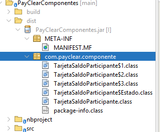

# PayClear - Documentación Técnica - SPRINT 3

* **Módulo:** Desarrollo de Interfaces (DII)
* **Equipo:** Jesús, José Luis, Guillermo
* **Fecha de entrega Sprint 3:** 20/11/2026

### Coevaluación
| Integrante | Nota (%) |
| :--- | :--- |
| Guillermo Eugui | 95% |
| Jesús Cabeza | 85% | 
| JoseLuís Segura | 95% |

## Pruebas, Calidad y Documentación (QA Tester)

**Responsable:** Guillermo Eugui Sánchez

Antes de integrar `TarjetaSaldoParticipante` en las vistas principales de PayClear, se han creado 6 pruebas automatizadas en `PayClearComponentes/test/TarjetaSaldoParticipanteTest.java`, totalmente desacoplada de `VistaPrincipal`, para validar el estado inicial, los setters, la lógica visual, el control de errores y los eventos del componente.

### Enfoque técnico (JUnit 4.13.2 + EDT nativo)

Como PayClear está desarrollado en Java Swing con FlatLaf y gestionado con **Ant** en NetBeans, se ha utilizado **JUnit 4.13.2 junto con Hamcrest** (que incluye `assertThrows`) para garantizar la compatibilidad total con el ejecutor de pruebas de Ant en el IDE, evitando los fallos de detección del motor de JUnit 5 en proyectos Ant. Para las pruebas de interacción de interfaz se simula el evento de ratón directamente sobre el Event Dispatch Thread (EDT) mediante `SwingUtilities.invokeAndWait` y `MouseEvent`.

### Resumen de los casos probados

| # | Método de prueba | Tipo | Qué se comprueba | Resultado |
| :-: | :--- | :--- | :--- | :-: |
| 1 | `testValoresPorDefecto` | Unitaria | Que el constructor sin argumentos inicialice el nombre a `"Participante"`, el saldo a `0.0` y el foco activado (`isFocusable()`). | PASS |
| 2 | `testSettersModificanEstadoInterno` | Unitaria | Que `setNombreParticipante` y `setSaldoActual` actualicen correctamente el estado interno (`assertEquals`). | PASS |
| 3 | `testEstadoVisualColoresPorSaldo` | Visual | Que el color de estado corresponda a acreedor (verde) con saldo positivo, deudor (rojo) con negativo y saldado (gris) con cero. | PASS |
| 4 | `testValoresNulosLanzanExcepcion` | Robustez | Que pasar nombre nulo o en blanco, o cualquiera de los tres colores a `null`, lance `IllegalArgumentException` (`assertThrows`). | PASS |
| 5 | `testClicDisparaActionListener` | UI (Ratón) | Que simular un clic izquierdo (`MouseEvent.MOUSE_CLICKED`) en el EDT notifique al `ActionListener` registrado. | PASS |
| 6 | `testCambioSaldoDisparaPropertyChangeEvent` | Eventos | Que modificar el saldo dispare un `PropertyChangeEvent` para `PROP_SALDO` con el valor antiguo (`0.0`) y el nuevo (`100.0`). | PASS |

### Salida de las pruebas

La batería completa se ha ejecutado desde NetBeans con el 100 % de las pruebas superadas (`6/6`) en `0,151 s`:

```text
Testsuite: TarjetaSaldoParticipanteTest
Tests run: 6, Failures: 0, Errors: 0, Skipped: 0, Time elapsed: 0,151 sec

test-single:
BUILD SUCCESSFUL (total time: 1 second)
```


## [3.4] Javadoc y empaquetado del `.jar`

**Responsable:** Guillermo Eugui Sánchez

Una vez cerradas las pruebas unitarias de `TarjetaSaldoParticipante`, he documentado el componente y he empaquetado el proyecto `PayClearComponentes` como librería independiente para poder importarlo desde la aplicación principal sin dependencias externas.

### Documentación del código y DocLint

* **Clase, constructor y métodos públicos:** Se han revisado todos los comentarios Javadoc de `TarjetaSaldoParticipante.java` añadiendo las etiquetas `@param`, `@return`, `@throws` (especialmente en los *setters* que lanzan `IllegalArgumentException` con valores nulos o vacíos) y `@see`.
* **Constantes públicas:** Se han documentado `PROP_NOMBRE`, `PROP_SALDO` y `TOLERANCIA` mostrando su valor real mediante `{@value}`.
* **Documentación del paquete:** Se ha creado `package-info.java` dentro de `com.payclear.componente` en `PayClearComponentes` (desde *New > Other > Java > Java Package Info*) explicando el propósito del paquete, el componente incluido y los requisitos de uso.
* **Reglas de DocLint:** Se ha limpiado el HTML de los comentarios para cumplir las comprobaciones estrictas de Javadoc: encabezados a partir de `<h2>`, listas `<ul>` fuera de etiquetas `<p>` y uso de `{@code ...}` para los símbolos `<` y `>`.

### Codificación UTF-8 y generación del Javadoc

Para evitar que las tildes, la `ñ` o el símbolo `✓` salieran rotos en Windows al generar el HTML, se ha comprobado que la codificación en *Properties > Sources* está en **UTF-8** y se han verificado las siguientes líneas en `PayClearComponentes/nbproject/project.properties`:

```properties
source.encoding=UTF-8
javadoc.additionalparam=-encoding UTF-8 -charset UTF-8 -docencoding UTF-8
```

Al ejecutar **Generate Javadoc** sobre `PayClearComponentes` se ha obtenido `BUILD SUCCESSFUL` sin errores de DocLint. Después se ha abierto `PayClearComponentes/dist/javadoc/index.html` en el navegador para comprobar que se renderizan bien las tildes, la descripción del paquete, el `enum Estado`, las constantes y todos los métodos públicos.


### Empaquetado del `.jar` y subida al repositorio

Se ha ejecutado **Clean and Build** sobre `PayClearComponentes` generando `PayClearComponentes/dist/PayClearComponentes.jar`. Revisando el contenido del archivo desde NetBeans se confirma que incluye el manifiesto (`META-INF/MANIFEST.MF`) y todas las clases compiladas del paquete `com.payclear.componente`:

* `TarjetaSaldoParticipante.class`
* `TarjetaSaldoParticipante$Estado.class`
* Clases internas de los *listeners* (`$1`, `$2`, `$3`)
* `package-info.class`

*(El componente no requiere recursos gráficos ni iconos adicionales dentro del `.jar`, ya que toda la parte visual se renderiza mediante colores y tipografía en Swing).*



Por último, como el `.gitignore` de la raíz bloqueaba cualquier carpeta `dist/`, se ha cambiado la regla `dist/` por `PayClear/dist/` para mantener ignorados los temporales de la aplicación principal pero permitir subir `PayClearComponentes/dist/PayClearComponentes.jar` y `PayClearComponentes/dist/javadoc/` al repositorio.

## Fuentes:
* *Willman Acosta Lugo -* [Generación Exitosa de Javadoc en Entornos Java Modernos
 ](https://informatica.uv.es/iiguia/LP/laboratorio/P1/p1.pdf)
* *Universitat de València -* [¿Qué es Javadoc, extra? , informatica.uv.es ](https://informatica.uv.es/iiguia/LP/laboratorio/P1/p1.pdf)
* *Roberto Canales Mora -* [Como usar Javadoc en Netbeans, adictosaltrabajo.com](https://adictosaltrabajo.com/2003/07/13/javadoc/)

